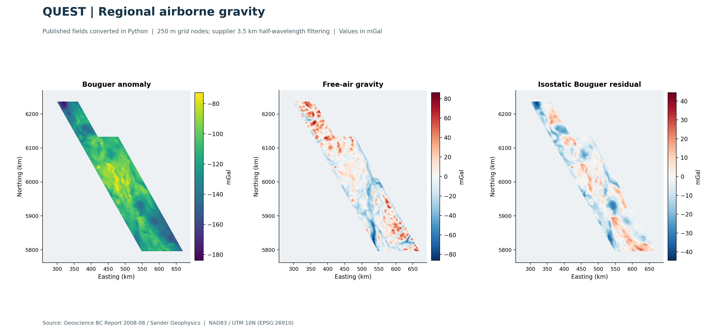

# QUEST airborne gravity | reproducible 2D analysis

A Python case study using **Geoscience BC's original QUEST gravity release**:
data auditing, georeferenced anomaly maps, line-data interpolation, whole-line
validation, and exploratory spatial analysis.

## Verified results

The full-data run processed **1,049,547 observations**, **340 line sections** and
**79,791 per-line block means**. No numeric missing values or duplicate
flight/line/time records were found. Five-fold validation withheld complete
planned traverse lines, keeping sections and reflights together.

| Interpolator | Held-line RMSE | MAE | Supported test blocks |
|---|---:|---:|---:|
| Linear | 1.912 mGal | 1.455 mGal | 98.8% |
| Inverse-distance squared | 1.934 mGal | 1.476 mGal | 98.8% |
| Nearest neighbour | 2.981 mGal | 2.273 mGal | 98.8% |

These are **conditional interpolation errors**, not independent survey accuracy.
The source data were already corrected, filtered and levelled. See the
[measured results](outputs/RESULTS.md) for interpretation and coverage limitations.

## What the project adds

- Audits conflicting CRS, file-format and gravity-channel descriptions.
- Reads the original XYZ observations and the release's binary Geosoft grids.
- Verifies grid orientation and channel correspondence numerically.
- Exports correctly georeferenced GeoTIFFs with units and no-data.
- Regrids the supplier's line-filtered Bouguer channel using explicit gap masks.
- Compares three interpolators using complete held-out planned lines.
- Examines regional/residual structure, scale sensitivity and horizontal gradients.
- Records source checksums, configuration, processing logs and package versions.

The work does not calculate gravity from raw accelerations, apply new terrain
corrections, identify mineral deposits or claim navigation positioning accuracy.

## Review the work

| File | Purpose |
|---|---|
| `outputs/QUEST_Gravity_Technical_Brief.pdf` | Illustrated technical summary |
| `outputs/RESULTS.md` | Measured outcomes and limits |
| `docs/METHODS.md` | Scientific choices and implementation |
| `docs/METADATA_ISSUES.md` | Conflicts, evidence and decisions |
| `docs/INTERVIEW_GUIDE.md` | Explain and defend the project |
| `docs/GITHUB_GUIDE.md` | Publish and present the repository |
| `notebooks/01_quest_walkthrough.ipynb` | Guided, runnable walkthrough |
| `config.json` | Processing parameters |
| `outputs/metadata.json` | Full run provenance and QC statistics |
| `outputs/tables/` | Channel statistics, fold scores, support and scale checks |
| `outputs/grids/` | GIS-ready products, regenerated locally and excluded from Git |

## GIS review

Open the GeoTIFFs in QGIS and use EPSG:26910. The supplier Bouguer, free-air and
isostatic products have 250 m nodes, with a published 3.5 km half-wavelength
filter. **Cell spacing is not geophysical resolution.** 
The independently regridded `bouguer100_linear_1000m.tif` uses a different supplier channel and
filtering history; its fine-looking details are **not** proof of additional resolution.

## Attribution and assistance

Data: Geoscience BC Report 2008-08; acquired and processed by Sander Geophysics Ltd.
[Official release and downloads](https://www.geosciencebc.com/major-projects/quest/).
The source archive and large generated files are deliberately excluded from Git;
source data are not relicensed here. See `docs/METHODS.md` for references and data rights.
